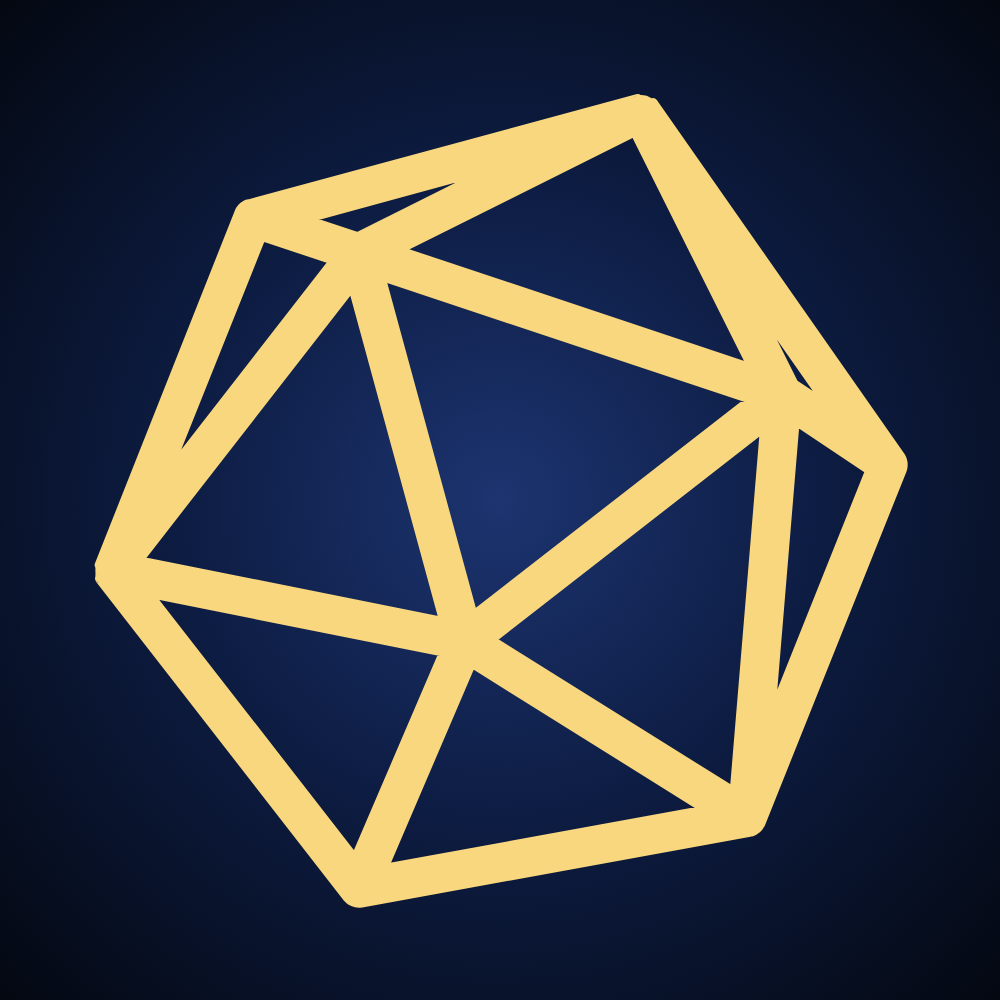

# The DnDGen Avatar



The d20 from the main theme's [album art](../theme-song/README.md#album-art), on its own. The album art can afford to be
stylish; the avatar is kept flat, with no title, ghost copies, or glow, so it reads cleanly at every size from the
organisation avatar down to a favicon.

## Files

This repository is public, so anything that needs the avatar can link to the file here instead of keeping a copy.
Link to the raw file, `https://raw.githubusercontent.com/DnDGen/.github/main/avatar/<file>`, not the `blob` page,
which is GitHub's web page about the file rather than the image itself.

| File | Size | For |
|---|---|---|
| [avatar.svg](avatar.svg) | Any | The source for all the others; also the site's SVG icon |
| [avatar-transparent.svg](avatar-transparent.svg) | Any | Just the d20, with no background and cropped to its edges, for a logo on a background of its own, like the site's navigation bar |
| [avatar.png](avatar.png) | 1000 × 1000 | The organisation avatar at [github.com/DnDGen](https://github.com/DnDGen), which every repository shows too |
| [avatar-512.png](avatar-512.png) | 512 × 512 | Web app manifest |
| [avatar-192.png](avatar-192.png) | 192 × 192 | Web app manifest |
| [avatar-180.png](avatar-180.png) | 180 × 180 | Apple touch icon, for a site saved to an iPhone or iPad home screen |
| [avatar-128.png](avatar-128.png) | 128 × 128 | NuGet package icon (NuGet recommends 128 × 128, PNG or JPEG, at most 1 MB) |
| [avatar-32.png](avatar-32.png) | 32 × 32 | Favicon, as a PNG |
| [favicon.ico](favicon.ico) | 32 × 32 | Favicon, for browsers and tools that look for `/favicon.ico` |

### NuGet Packages

A NuGet package can't link to its icon: the icon has to be packed inside the package, named by `<PackageIcon>`.
The old `<PackageIconUrl>` is deprecated, and packing with only that raises warning NU5048. So each package packs
`avatar-128.png`, either a copy of it or one downloaded from the raw URL when the package is built.

### dndgen.com

A site can link to the raw files from its `<head>`:

```html
<link rel="icon" href="https://raw.githubusercontent.com/DnDGen/.github/main/avatar/favicon.ico" sizes="32x32">
<link rel="icon" href="https://raw.githubusercontent.com/DnDGen/.github/main/avatar/avatar.svg" type="image/svg+xml">
<link rel="apple-touch-icon" href="https://raw.githubusercontent.com/DnDGen/.github/main/avatar/avatar-180.png">
```

Browsers and other tools that ask the site itself for `/favicon.ico` won't follow these links, so the site may still
want `favicon.ico` at its root.

For a logo beside the DnDGen name, such as in the navigation bar, `avatar-transparent.svg` sits on the bar's own
colour instead of a dark blue square:

```html
 DnDGen
```

## Rendering

Every PNG and `favicon.ico` is rendered from [avatar.svg](avatar.svg) by [render.ps1](render.ps1), with headless Edge:

```powershell
./render.ps1
```

It renders `avatar.png` at 1000 × 1000, then scales it down to each smaller size, since headless Edge won't render a
window much smaller than 500 pixels. After changing `avatar.svg`, run it again and commit every file it changes.

- The d20 and the background are the album art's. The d20 is 85% of its size there, centred, and drawn with a thin
  outline of its own colour, which thickens its lines enough to stay clear at 32 × 32.
- The d20 is the dndgen.com loading spinner, from [DnDGen.Web](https://github.com/DnDGen/DnDGen.Web/blob/main/dndgen-web/src/assets/loadingDice.svg),
  originally from [a gist by hperantunes](https://gist.github.com/hperantunes/f4c2fd407c2ea74c6c9d).
  A change to the d20 in the album art should be made here as well.
- `avatar-transparent.svg` isn't rendered: it's only needed as an SVG. It has its own copy of the d20, with the same
  colour and outline, since an SVG loaded as an image can't use another file. A change to the d20 in `avatar.svg`
  should be made there as well.
