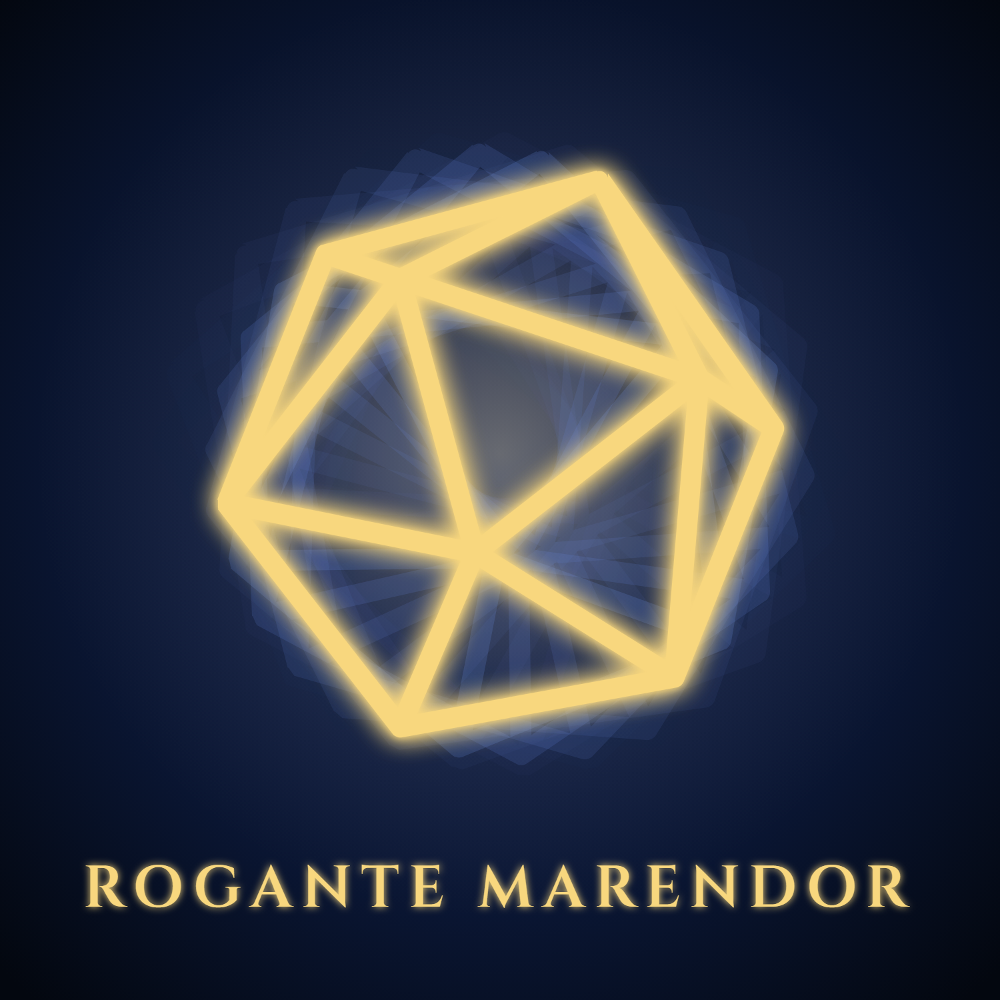

# Rogante Marendor -DnDGen Main Theme-

[](https://suno.com/s/bv8TJG5bYGeL21dp)

The DnDGen theme song: an orchestral boss battle theme, sung by a choir in Latin and Middle High German.
It is the overture for the whole organization, so its lyrics come from the [organization README](../profile/README.md),
and it introduces the leitmotif for each generator.

**Listen on [Suno](https://suno.com/s/bv8TJG5bYGeL21dp).**

## Remixing

The song follows the organization README. Most changes won't need a new version, but when the README changes in a way the song should reflect:

1. Update the lyrics and translation below to match the new README.
2. Remix the song in Suno with the updated lyrics.
3. Update the Suno link here and in the organization README.

## Style

```
Epic cinematic video game boss battle theme, JRPG final-boss hybrid orchestral score with modern trailer-music production, Massive choir chanting in Latin and Middle High German, with a distant solo soprano, Opens with an ominous low drone and a lone horn stating a heroic leitmotif, Explodes into a relentless boss fight: driving minor-key string ostinato, thundering taiko and epic drums, punchy modern drum kit, deep brass braams, sub-bass hits and risers, choir hammering in rhythmic unison with call-and-response shouts, Drops into a tragic lament: choir and soft strings over a low pulse, vast and sorrowful, Builds to a final-phase climax: full orchestra and choir at maximum power, pipe organ, bells, soaring horns restating the leitmotif in a triumphant major key, huge cymbal swells, Ends with the lone horn and hushed choir fading into a rumble of distant thunder, Big, wide, hard-hitting soundtrack mix, deadly serious about rolling dice
```

## Lyrics

```
[Intro - ominous low drone, lone horn states the leitmotif]

[Distant solo soprano]
Rogante Marendor
(Rogante Marendor)

[Choir enters, hushed, building]
Uns ist in alten maeren
Wunders vil geseit
Cryptae et dracones
Editio tertia
Alea iacta est
(Alea iacta est)

[Boss Battle - driving strings, thundering taiko and drums, brass braams, choir in unison, call and response]
Iacite aleas!
Der wurfel vellet!
(Grollen! Grollen!)
Hort unde zouber, wafen guot!
(Argenteus Re!)
Recken wol gewafent!
(Erchant Grace!)
Wunder unde wurme!
(Centaur Rege!)
Strit in der enge!
(Enge Nocturne!)
Kerker gar!
(Ongen Gunde!)
Rogante Marendor!
Rogante Marendor!

[Lament - choir and soft strings over a low pulse]
Ein valsch verborgen
In tusent wurfen
Unde schinet in einem
In einem
(In einem)

[Final Phase - full orchestra and choir at maximum power, organ, bells, horns restate the leitmotif]
Aber unde aber!
Wir suochen den wurf, der ez brichet!
Mer danne hundert tusent pruevunge!
Electores centesimae et collectionis!
Der grunt under in allen
Bibliotheca, in dinem werke
Cryptae et dracones!
ALEA IACTA EST!
ROGANTE MARENDOR!

[Epilogue - lone horn returns to the leitmotif, choir hushed, fading]
Rogante Marendor
(Grollen)
Alea iacta est

[Outro - rumbling sound of distant thunder, soft timpani roll, fading to silence]
[End]
```

## Translation

Names are in Latin (or are anagrams), descriptions are in Middle High German (MHG), and the dice refrain is Latin.
The MHG is approximate.

| Lyric | Language | English | From the README |
|---|---|---|---|
| Rogante Marendor | Anagram | RANDOM GENERATOR | "Random generators" |
| Uns ist in alten maeren / Wunders vil geseit | MHG | In old tales, many wonders are told to us | Not from the README: the opening line of the *Nibelungenlied* |
| Cryptae et dracones | Latin | Dungeons and dragons | "Dungeons & Dragons 3.X" |
| Editio tertia | Latin | Third edition | "3.X" |
| Alea iacta est | Latin | The die is cast | Dice |
| Iacite aleas | Latin | Throw the dice | Dice |
| Der wurfel vellet | MHG | The die falls | RollGen: "Dice rolls" |
| Hort unde zouber, wafen guot | MHG | Hoard and magic, good weapons | TreasureGen: "Equipment and magic items" |
| Recken wol gewafent | MHG | Warriors, well armed | CharacterGen: "Fully equipped NPCs" |
| Wunder unde wurme | MHG | Monsters and wyrms | CreatureGen: "Fleshed-out creatures" |
| Strit in der enge | MHG | Battle in the narrow pass | EncounterGen: "Encounters" |
| Kerker gar | MHG | Whole dungeons | DungeonGen: "whole dungeons" |
| Ein valsch verborgen / In tusent wurfen / Unde schinet in einem | MHG | A flaw, hidden in a thousand rolls, and it shows in one | "a bug might only show up on one roll in thousands" |
| Aber unde aber | MHG | Again and again | Stress: "over and over" |
| Wir suochen den wurf, der ez brichet | MHG | We seek the roll that breaks it | "looking for the roll that breaks it" |
| Mer danne hundert tusent pruevunge | MHG | More than a hundred thousand tests | "over 100,000 tests" |
| Electores centesimae et collectionis | Latin | Selectors of Percentile and Collection | Infrastructure: "the Percentile and Collection selectors" |
| Der grunt under in allen | MHG | The ground beneath them all | Infrastructure: "Core objects shared by the generators" |
| Bibliotheca, in dinem werke | Latin, MHG | A library, in your work | "a C# library you can use in your own code" |

## Leitmotifs

Each generator has a secret name: an anagram of its repository name.
The choir shouts them in the Boss Battle, and each generator's own theme song should bring its name back.
The support libraries (Stress, Infrastructure, and Web) have no leitmotif: their songs describe their READMEs as they are.

| Repository | Leitmotif | Meaning |
|---|---|---|
| DnDGen (Random Generator) | Rogante Marendor | The incantation for the whole organization |
| [RollGen](https://github.com/DnDGen/DnDGen.RollGen) | Grollen | German: a rumble, or roll, of thunder |
| [TreasureGen](https://github.com/DnDGen/DnDGen.TreasureGen) | Argenteus Re | Latin: silver in substance |
| [CharacterGen](https://github.com/DnDGen/DnDGen.CharacterGen) | Erchant Grace | A name or a title |
| [CreatureGen](https://github.com/DnDGen/DnDGen.CreatureGen) | Centaur Rege | Latin: a centaur, by the king |
| [EncounterGen](https://github.com/DnDGen/DnDGen.EncounterGen) | Enge Nocturne | A narrow pass at night: an ambush |
| [DungeonGen](https://github.com/DnDGen/DnDGen.DungeonGen) | Ongen Gunde | Old High German *gund*: battle |

## Soundtrack Plan

Each repository will get its own theme, like the areas of an RPG soundtrack: different genres, tied together by their leitmotifs.
These genres are proposals until each song is written; a written song's row links to it.

| Repository | Genre | Area |
|---|---|---|
| [Stress](https://github.com/DnDGen/DnDGen.Stress) | Forge folk metal: [listen](https://suno.com/s/TLKVK477Efrel4u8) · [lyrics and notes](https://github.com/DnDGen/DnDGen.Stress/blob/main/docs/theme-song/README.md) | The forge, proving steel by striking it over and over |
| [RollGen](https://github.com/DnDGen/DnDGen.RollGen) | Tavern gambling and drinking song | The tavern |
| [TreasureGen](https://github.com/DnDGen/DnDGen.TreasureGen) | Pirate shanty | The treasure hunt |
| [DungeonGen](https://github.com/DnDGen/DnDGen.DungeonGen) | Dungeon synth | The dungeon crawl |
| [EncounterGen](https://github.com/DnDGen/DnDGen.EncounterGen) | Epic battle theme | Combat |
| [CreatureGen](https://github.com/DnDGen/DnDGen.CreatureGen) | Dark Nordic folk | The bestiary |
| [CharacterGen](https://github.com/DnDGen/DnDGen.CharacterGen) | Troubadour ballad | One hero's story |
| [Infrastructure](https://github.com/DnDGen/DnDGen.Infrastructure) | Gregorian chant | The scripture everything is built on |
| [Web](https://github.com/DnDGen/DnDGen.Web) | Royal herald fanfare | Announcing it all to the public |

## New Theme Songs

Every repository gets a theme song, including any new one:

1. **Plan it.** Add the repository to the Soundtrack Plan with a proposed genre and area. A generator also gets a
   leitmotif, an anagram of its repository name; the support libraries don't.
2. **Write it from the README.** The lyrics come from the repository's README, sung as words, never as code: no
   method calls, property names, commands, or formulas. The song is recorded in that repository's
   `docs/theme-song/README.md`, with its sources, album art, and update procedure.
   [DnDGen.Stress](https://github.com/DnDGen/DnDGen.Stress/blob/main/docs/theme-song/README.md) is the first example.
3. **Start from the main theme.** Every draft before the song first merges (v0.1, v0.2, and so on) is a fresh
   generation that Samples this song's "Rogante Marendor" snippet, 3:00.0 to 3:17.1. The take that merges is v1,
   and each update after that Covers the repository's current song instead.

## Suno Notes

Lessons from generating this song, for the next remix:

- **Name the sound, not the tradition.** Composer names, "Romantic", and tempo markings like Lento and Adagio made it sound like a concert hall. Boss battle and trailer music words (taiko, braams, risers, final phase) got the cinematic sound.
- **German can turn into growled or spoken vocals.** The other take of this generation growled the German, and this one speaks some of it later on.
- **Parentheses make the second voice.** They give the call-and-response its contrast, so keep them. Suno will still sometimes drop a response: this take skips *Argenteus Re*.
- **Don't over-steer.** A later attempt to split the voices (female calls, male answers), add a `[Call and Response]` tag, and replace the repeated openings with MHG calls made the German growl again and dropped the *Rogante Marendor* echo.
- **Limits:** 1,000 characters for the style, 80 for the title. Replace Section, which would fix a single dropped response, is not on the free plan.

## Album Art

[cover.png](cover.png) is rendered from [cover.html](cover.html), which you can open in any browser.
To render it again at 1500 × 1500:

```
msedge --headless --hide-scrollbars --allow-file-access-from-files --window-size=1500,1500 --screenshot=cover.png cover.html
```

- The d20 is the dndgen.com loading spinner, from [DnDGen.Web](https://github.com/DnDGen/DnDGen.Web/blob/main/dndgen-web/src/assets/loadingDice.svg), originally from [a gist by hperantunes](https://gist.github.com/hperantunes/f4c2fd407c2ea74c6c9d). The ghost copies behind it are its spin: every roll that came before.
- The title is set in [Cinzel](https://github.com/NDISCOVER/Cinzel), included as [Cinzel.ttf](Cinzel.ttf) under the [SIL Open Font License](Cinzel-OFL.txt).
